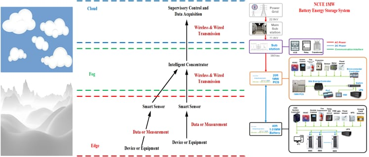
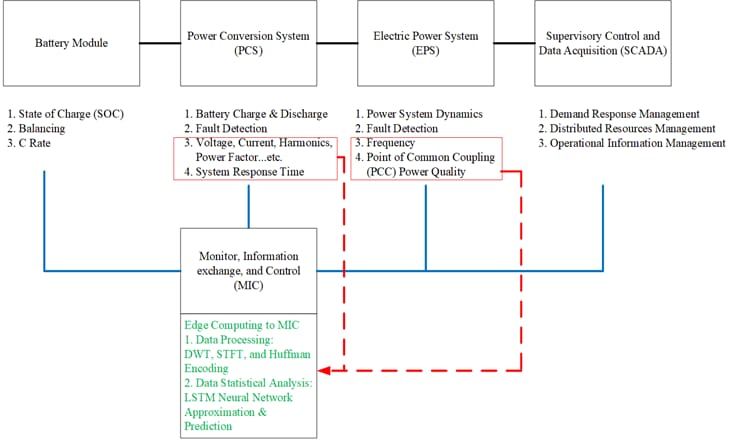
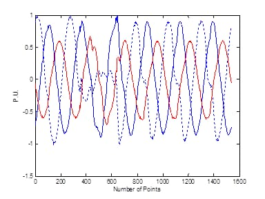

彰師大校內設有 1 MW 電池儲能系統（BESS），並搭配太陽能發電，是亞洲第一座由大學營運的百萬瓦級儲能系統。實驗室以 AI 與邊緣運算協助其運轉：邊緣裝置以離散小波轉換（DWT）、短時傅立葉轉換（STFT）與 Huffman 編碼處理量測資料，再以 LSTM 類神經網路逼近並預測系統行為。<!-- source: 楊老師 TEEP 2023（SDG 7）與 IIPP 2024 簡報，Brian 提供（2026-10-18） -->

研究涵蓋整條鏈路：電池模組（荷電狀態、平衡、充放電倍率）、電力轉換系統（充放電、故障偵測、電壓、電流、諧波與功率因數）、電力系統動態與頻率，以及併接點的電力品質，目標是零耗能校園，呼應聯合國永續發展目標 SDG 7（可負擔的潔淨能源），特別是 7.A（加強國際合作，促進潔淨能源研究與技術的取得）與 7.B（擴建並升級基礎設施，提供現代且永續的能源服務）；實驗室的國際實習計畫即是對 7.A 的實踐。實驗室也量測並建模超級電容與電池。<!-- source: Brian，2026-10-17（1 法拉超級電容數據） -->

監測系統分為三層：邊緣層由智慧感測器量測設備；霧層由智慧集中器透過有線與無線傳輸匯集資料；雲端則由監控與資料擷取系統（SCADA）負責需量反應、分散式資源管理與營運資訊管理。在電池、電力轉換系統與電網之間，有一個監控、資訊交換與控制模組（MIC）負責邊緣運算：資料處理（DWT、STFT 與 Huffman 編碼）與資料分析（以 LSTM 逼近與預測）。<!-- source: 楊老師 TEEP 2023（SDG 7）與 IIPP 2024 簡報，Brian 提供（2026-10-24） -->

這個方向延續楊老師在電力電子與電力品質的研究（見下方論文）：小波式電壓驟降監測、閃爍量測、類神經網路電力擾動辨識、飛輪儲能、電池充電與諧振式轉換器。

**歷屆碩士論文。** 儲能方面，學生做出了[電池平衡系統](https://hdl.handle.net/11296/jy6862)、[具容錯能力的電池儲能系統](https://hdl.handle.net/11296/p993sg)與其[兼具電池平衡、應用於直流微電網的版本](https://hdl.handle.net/11296/a4c9a3)，以及[電池充電狀態與內部溫升的 AI 估測](https://hdl.handle.net/11296/e4s4a3)。電力品質方面則有[嵌入式電壓閃爍量測系統](https://hdl.handle.net/11296/pfb8t4)、[以 LSTM 預測太陽能系統電流諧波](https://hdl.handle.net/11296/eums9d)與[多模態融合的太陽能電力品質分析](https://hdl.handle.net/11296/5z3bjn)。
